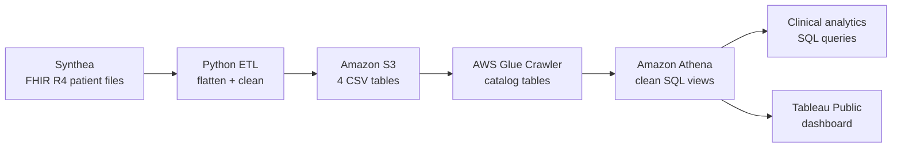

# ☁️ Serverless Clinical Data Warehouse on AWS — From FHIR Records to Population Health Insights
 


 
> An end-to-end, serverless healthcare analytics pipeline that turns raw patient records in **HL7 FHIR R4** format into a clean, query-ready data warehouse on AWS — and uses it to answer the questions clinical quality teams ask every day: *Who has which chronic conditions? Are they on the right medications? Who is overdue for screening?*
>
> **Personal Project · Built with synthetic patient data from Synthea; no real patient information involved**
 
🎥 **[Watch the 5-Minute Demo](#)** · 📊 **[Preview the Live Tableau Dashboard](#)**
  
---
 
## 🎯 The Problem
 
Hospitals and health systems exchange patient records using **FHIR**, the industry standard for health data. 
Each patient's record arrives as one large, deeply nested file, which works well for a single doctor's visit but is slow and impractical for questions about **thousands of patients at once**.
 
That makes it hard for clinical quality teams to:
- Track how common chronic diseases are across the patient population
- Check whether diagnosed patients received the expected medications
- Find high-risk patients who are overdue for lab tests

**The goal:** build a low-cost, low-maintenance cloud pipeline that flattens FHIR records into simple, connected tables, so anyone can answer these questions with SQL or a dashboard, and pay nothing for computing power when no one is running a query.
 
---
 
## 🏗️ How It Works
 

 
1. **Generate data.** Synthea creates realistic synthetic patients, complete with conditions, medications and lab results, in FHIR R4 format.
2. **Flatten and clean (Python).** A Python script reads each nested patient file and splits it into four simple tables: patients, conditions, medications and lab results.
3. **Store (Amazon S3).** Each table is stored in its own folder in S3, AWS's file storage.
4. **Catalog (AWS Glue).** A Glue crawler scans the folders and registers each table, so it can be queried like a database.
5. **Clean and query (Amazon Athena).** SQL views clean up the remaining data issues and organize the tables for analysis. Athena runs the queries directly on the files in S3.
6. **Visualize (Tableau Public).** Query results power an interactive population health dashboard.
---
 
## 🗂️ Data Model
 
The warehouse uses a **star schema**: one central table describing each patient, connected to three tables that record what happened to them over time. This keeps patient details in one place and prevents the duplicate rows that come from joining nested records.
 
| View | Type | What It Holds | Cleaning Applied in SQL |
|---|---|---|---|
| `dim_patients` | Patient details | ID, name, gender, age, city, state | Extracts readable names from file IDs, formats birth dates and calculates age |
| `fact_conditions` | Diagnoses | Condition, start date, end date, status | Removes "(disorder)" labels and marks conditions with no end date as **Ongoing** |
| `fact_medications` | Prescriptions | Medication, prescribed date, status | Fixes split text from commas and removes long dosage descriptions |
| `fact_lab_results` | Lab tests | Test name, value, unit, test date | Removes coding tags like "[Ratio]" and keeps units, so values on different scales aren't compared by mistake |
 
---
 
## 📊 Key Insights
 
| Analysis | What It Answers | Finding |
|---|---|---|
| **Disease prevalence by gender** | Which conditions are most common, and in whom? | Gingivitis was the most common condition (87 patients); essential hypertension affected 16 |
| **Ongoing vs. resolved conditions** | Which patients need long-term care? | Separates short-term illnesses (sinusitis, bronchitis) from chronic conditions (anemia, hypertension, heart disease) |
| **Diagnosis to treatment** | Were patients prescribed the expected medication after diagnosis? | Confirmed standard first-line medications (lisinopril, metformin, simvastatin) for patients with diabetes and hypertension |
| **Screening coverage** | How many patients have key heart and diabetes tests on record? | BMI for 107 patients (average 25.8), cholesterol panels for 64, HbA1c for 39 (average 5.15%) |
| **High-risk diabetes outreach** | Which patients need follow-up? | Flags diabetic patients with HbA1c above 6.5% (e.g. 7.30%, 6.84%) and those missing a recent test |
 
All SQL views, queries, and results are in [`/sql`](sql/).
 
---
 
## ⚖️ Why This Design
 
| Choice | Benefit |
|---|---|
| **Serverless (S3 + Athena)** | No servers to manage, and no computing cost when no one is querying — you pay only per query |
| **Cleaning in SQL views** | Raw data stays untouched; every cleaning rule is visible and easy to change |
| **HIPAA-eligible services** | S3, Glue and Athena support encryption, access controls and audit logs, so the same design could handle real patient data |
| **Clear path to scale** | For hundreds of users querying at once, the same tables can move to Amazon Redshift without changing the dashboard |
 
---
 
## 🧰 Tech Stack
 
| Category | Tools |
|---|---|
| **Synthetic data** | Synthea (HL7 FHIR R4) |
| **ETL** | Python |
| **Cloud storage** | Amazon S3 |
| **Data catalog** | AWS Glue |
| **Querying** | Amazon Athena (SQL) |
| **Visualization** | Tableau Public |
 
---
 
## 🚀 How to Reproduce
 
1. **Build the tables.** Run `python etl/build_clinical_warehouse.py` on a folder of Synthea FHIR R4 `.json` files to create the four CSV tables.
2. **Upload to S3.** Put each CSV in its own folder: `s3://<bucket>/warehouse/patients/`, `/conditions/`, `/medications/` and `/lab_results/`.
3. **Catalog with Glue.** Point a Glue crawler at the four folders to register the tables in `clinical_warehouse_db`.
4. **Query in Athena.** Run `sql/01_create_semantic_views.sql` to build the clean views, then `sql/02_clinical_analytics.sql` for the analyses.
---
 
## 📁 Repository Structure
 
```
Healthcare-AWS-Cloud/
├── README.md
├── etl/
│   └── build_clinical_warehouse.py     # Flattens FHIR files into 4 CSV tables
├── sql/
│   ├── 01_create_semantic_views.sql    # Star schema views and data cleaning
│   └── 02_clinical_analytics.sql       # Population health queries
└── images/
    └── dashboard_preview.png
```
 
---
