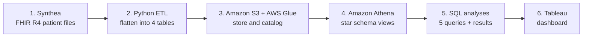

# ☁️ Serverless Clinical Data Warehouse on AWS: From FHIR Records to Population Health Insights
 


 
> An end-to-end healthcare analytics pipeline that turns raw patient records in **HL7 FHIR R4** format into a clean, query-ready data warehouse on AWS, then uses it to answer the questions clinical quality teams ask every day: *Who has which chronic conditions? What are they being prescribed? Which diabetic patients need follow-up?*
>
> **112 synthetic patients · 1,148 diagnoses · 2,650 prescriptions · 27,199 lab results**
>
> **Personal Project · All patient data is synthetic, generated by Synthea. No real patient information is used**
 
🎥 **[Watch the 5-minute demo](https://www.loom.com/share/8caec3f17928453faf0ce3c2a55a9a79)**


 
---
 
## 🎯 The Problem
 
Hospitals and health systems share patient records using **FHIR**, the industry standard for health data. Each patient's record arrives as one large file with information nested many layers deep — every visit, diagnosis, prescription and lab test bundled together.
 
That format works well when a doctor opens one patient's chart. It's slow and impractical when a clinical quality team needs answers about **an entire patient population**, such as:
 
- How common is each chronic disease, and in which groups?
- What medications are patients with hypertension or diabetes receiving?
- Which diabetic patients have poorly controlled blood sugar, or no test on record?

**The goal:** Build a low-cost cloud pipeline that turns nested FHIR files into simple, connected tables, so these questions can be answered with SQL and a dashboard, with no servers to manage and no computing cost when no one is running a query.
 
---
 
## 🏗️ The Pipeline at a Glance
 

 
---
 
## 1️⃣ Generating the Data — Synthea
 
**[Synthea](https://synthetichealth.github.io/synthea/)** is an open-source tool that simulates realistic patients from birth onward — their visits, diagnoses, medications and lab results — without using any real person's data. It outputs one **FHIR R4 file per patient**.
 
I generated **112 synthetic patients**. Each file is a FHIR "bundle": a single JSON document containing hundreds of nested records, each with a type such as `Patient`, `Condition`, `MedicationRequest` or `Observation`.
 
📂 **[`data/raw/`](data/raw/)** contains a sample of 10 patient files, so you can see the raw format the pipeline starts from.
 
---
 
## 2️⃣ Flattening the Data — Python ETL
 
📄 **[`etl/build_clinical_warehouse.py`](etl/build_clinical_warehouse.py)**
 
**Why:** FHIR files are nested, which suits sharing one patient's record but not analyzing thousands. The ETL step flattens them once into simple tables that SQL and Tableau can read.
 
**How:** The script reads each patient file, sorts every record by type, keeps only the fields needed, and writes them to four CSV tables. The file name becomes the `patient_id` that links all four tables.
 
| FHIR Record | Output Table | Rule Applied | Rows |
|---|---|---|---|
| `Patient` | `patients.csv` | Demographics only | 112 |
| `Condition` | `conditions.csv` | Clinical **disorders** only; social findings like *"Unemployed"* are skipped | 1,148 |
| `MedicationRequest` | `medications.csv` | Records without a medication name are skipped | 2,650 |
| `Observation` | `lab_results.csv` | **Numeric** results only; survey text answers are skipped | 27,199 |
 
Hospital and practitioner files are excluded, and dates are trimmed to `YYYY-MM-DD` so Athena can read them as dates.
 
---
 
## 3️⃣ Storing and Cataloging — Amazon S3 + AWS Glue
 
Each CSV is uploaded to its own folder in **Amazon S3**. An **AWS Glue Crawler** then scans the folders and registers them as tables in `clinical_warehouse_db`, so they can be queried with SQL without loading them into a database.
 
Glue didn't detect the header row on three tables, naming their columns `col0`, `col1` and so on. The views in step 4 rename these columns and remove the stray header row.
 
---
 
## 4️⃣ Building the Warehouse — Star Schema Views
 
📂 **[`sql/views/`](sql/views/)**
 
**Why a star schema:** patient details are stored **once** in a dimension table, and everything that happened to each patient is stored in fact tables linked by `patient_id`. This avoids repeating names and addresses across 27,000+ lab rows and keeps every analysis a simple join.
 
```
                       fact_conditions
                              │
fact_medications ──────── dim_patients ──────── fact_lab_results
```
 
**Why views:** each table is an Athena view — a saved query that cleans the raw data each time it runs. The raw data stays untouched, and every cleaning rule is visible in SQL.
 
| View | Type | One Row Per | Key Cleaning |
|---|---|---|---|
| [`dim_patients`](sql/views/dim_patients.sql) | Dimension | Patient | Extracts a readable name (`Ignacio928_Hartmann983_…` → **Ignacio Hartmann**) and calculates age |
| [`fact_conditions`](sql/views/fact_conditions.sql) | Fact | Diagnosis | Removes "(disorder)" labels and marks conditions with no end date as **Ongoing** |
| [`fact_medications`](sql/views/fact_medications.sql) | Fact | Prescription | Shortens drug names (`lisinopril 10 MG Oral Tablet` → **lisinopril**) |
| [`fact_lab_results`](sql/views/fact_lab_results.sql) | Fact | Lab result | Removes coding tags like `[Mass/volume]`, keeps numeric values only, and preserves units |
 
---
 
## 5️⃣ Analyzing the Data — SQL Queries and Results
 
📂 **[`sql/queries/`](sql/queries/)** · 📂 **[`sql/results/`](sql/results/)**
 
Each query has a matching result file with the same number, exported from Athena as CSV.
 
| # | Analysis | How It Works | Key Finding | Files |
|---|---|---|---|---|
| 1 | **Disease prevalence by gender** | Counts unique patients per condition and gender | Gingivitis was most common (52 female, 35 male); hypertension affected 10 women and 6 men | [Query](sql/queries/01_disease_prevalence_by_gender.sql) · [Result](sql/results/01_disease_prevalence_by_gender.csv) |
| 2 | **Active vs. resolved conditions** | Splits each condition by active or resolved status | Largest ongoing groups: anemia (22), hypertension (16), ischemic heart disease (11) | [Query](sql/queries/02_active_vs_resolved_conditions.sql) · [Result](sql/results/02_active_vs_resolved_conditions.csv) |
| 3 | **Diagnosis to treatment** | Links hypertension and diabetes diagnoses to medications prescribed on or after the diagnosis date, excluding common painkillers and antibiotics | Lisinopril was most common for both hypertension (14 patients) and type 2 diabetes (5) | [Query](sql/queries/03_diagnosis_to_treatment.sql) · [Result](sql/results/03_diagnosis_to_treatment.csv) |
| 4 | **Screening coverage** | Counts tested patients and averages key lab values, grouped by unit | BMI for 107 patients (avg 25.8), cholesterol for 64, HbA1c for 39 (avg 5.15%) | [Query](sql/queries/04_cardiometabolic_screening.sql) · [Result](sql/results/04_cardiometabolic_screening.csv) |
| 5 | **Diabetic outreach list** | Lists each diabetic patient's average HbA1c and BMI | Of 8 diabetic patients, **3 had HbA1c above 6.5%** and **2 had no HbA1c on record** | [Query](sql/queries/05_diabetic_patient_biomarkers.sql) · [Result](sql/results/05_diabetic_patient_biomarkers.csv) |
 
*All patient names in the results are synthetic, generated by Synthea.*
 
---
 
## 6️⃣ Visualizing the Results — Tableau Dashboard
 
📂 **[`dashboard_preview/`](dashboard_preview/)**
 
The query results feed an interactive **HL7 FHIR Population Health Analytics Dashboard** with four views:
 
| Panel | Built From | What It Shows |
|---|---|---|
| **Top 10 Clinical Conditions by Gender** | Query 1 | Most common conditions, split by female and male patients |
| **Active Chronic vs. Resolved Acute Conditions** | Query 2 | Ongoing conditions (red) next to resolved ones (green) |
| **Targeted Prescriptions by Chronic Condition** | Query 3 | Medications prescribed after a hypertension or diabetes diagnosis |
| **Diabetic Outreach: Individual BMI & HbA1c Control** | Query 5 | Each diabetic patient's average BMI and HbA1c, color-coded so high values stand out |
 
**Filters** for condition, gender and clinical status let users narrow every panel to the group they care about.
 

 
🎥 **[Watch the Video Walkthrough](VIDEO_LINK_HERE)** for a tour of the full pipeline and dashboard.
 
---
 
## ⚖️ Why This Design
 
| Choice | Benefit |
|---|---|
| **Serverless (S3 + Athena)** | No servers to manage; you pay only when a query runs |
| **HIPAA-eligible services** | S3, Glue and Athena support encryption, access controls and audit logs, so the same design could be extended to real patient data |
| **Clear path to scale** | For many users querying at once, the same tables can move to Amazon Redshift without changing the analyses |
 
---
 
## 🧰 Tech Stack
 
| Category | Tools |
|---|---|
| **Synthetic data** | Synthea (HL7 FHIR R4) |
| **ETL** | Python (json, csv) |
| **Cloud storage** | Amazon S3 |
| **Data catalog** | AWS Glue Crawler |
| **Warehouse and querying** | Amazon Athena (SQL) |
| **Visualization** | Tableau |
 
---
 
## 🚀 How to Reproduce
 
1. **Generate patients.** Run Synthea to create FHIR R4 patient files, or use the sample in `data/raw/`.
2. **Run the ETL.** From the folder containing the patient files, run `python etl/build_clinical_warehouse.py`. It creates the four CSV tables in a `clinical_warehouse/` folder (copies are saved in `data/processed/`).
3. **Upload to S3.** Put each CSV in its own folder: `s3://<bucket>/warehouse/patients/`, `/conditions/`, `/medications/` and `/lab_results/`.
4. **Catalog with Glue.** Point a Glue crawler at the four folders to register the tables in `clinical_warehouse_db`.
5. **Build the views.** Run each file in `sql/views/` in Athena.
6. **Run the analyses.** Run each file in `sql/queries/`. The output matches `sql/results/`.
7. **Build the dashboard.** Load the result tables into Tableau.
---
 
## 📁 Repository Structure
 
```
Healthcare-AWS-Cloud/
├── README.md
├── dashboard_preview/
│   └── Tableau Dashboard.png                 # Dashboard screenshot
├── data/
│   ├── raw/                                  # Sample of 10 Synthea FHIR R4 patient files (.json)
│   └── processed/                            # 4 flat tables created by the ETL
│       ├── patients.csv
│       ├── conditions.csv
│       ├── medications.csv
│       └── lab_results.csv
├── etl/
│   └── build_clinical_warehouse.py           # Flattens FHIR files into the 4 CSV tables
└── sql/
    ├── views/                                # Star schema views (dimension + facts)
    │   ├── dim_patients.sql
    │   ├── fact_conditions.sql
    │   ├── fact_medications.sql
    │   └── fact_lab_results.sql
    ├── queries/                              # 5 population health analyses
    │   ├── 01_disease_prevalence_by_gender.sql
    │   ├── 02_active_vs_resolved_conditions.sql
    │   ├── 03_diagnosis_to_treatment.sql
    │   ├── 04_cardiometabolic_screening.sql
    │   └── 05_diabetic_patient_biomarkers.sql
    └── results/                              # Query output, one CSV per query
        ├── 01_disease_prevalence_by_gender.csv
        ├── 02_active_vs_resolved_conditions.csv
        ├── 03_diagnosis_to_treatment.csv
        ├── 04_cardiometabolic_screening.csv
        └── 05_diabetic_patient_biomarkers.csv
```
